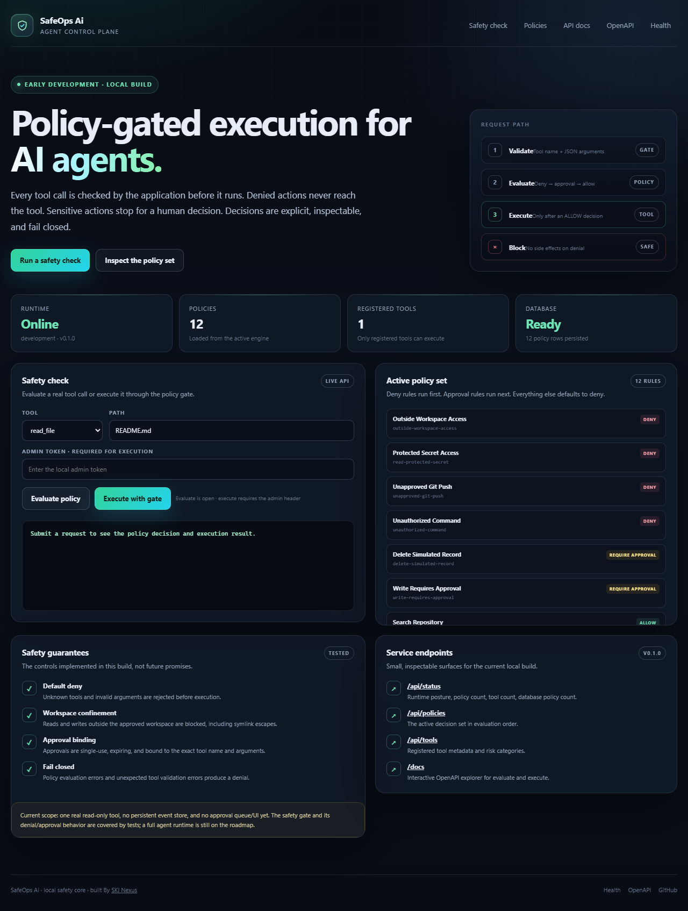
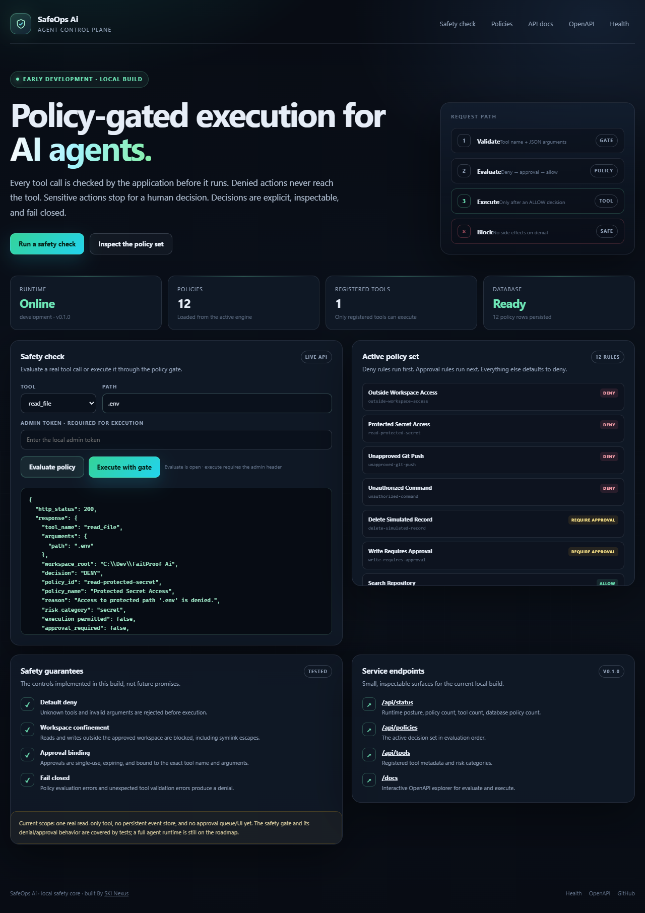
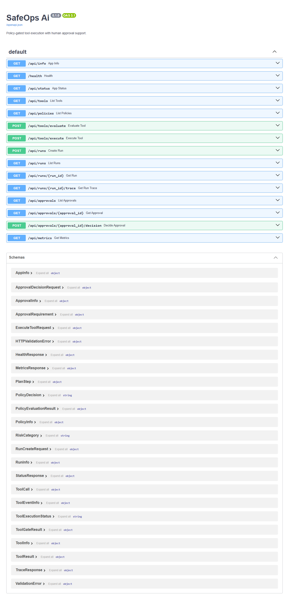
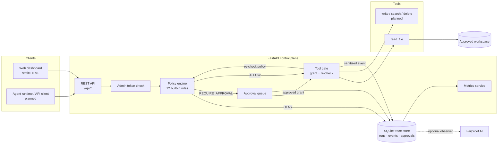
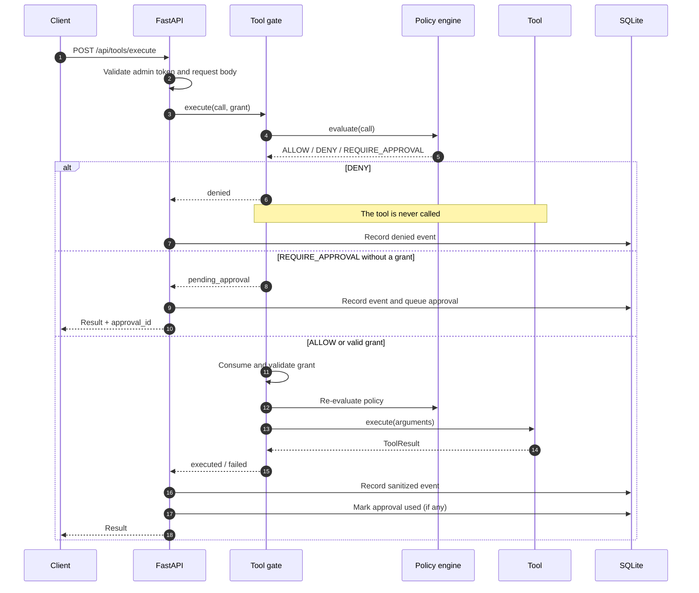
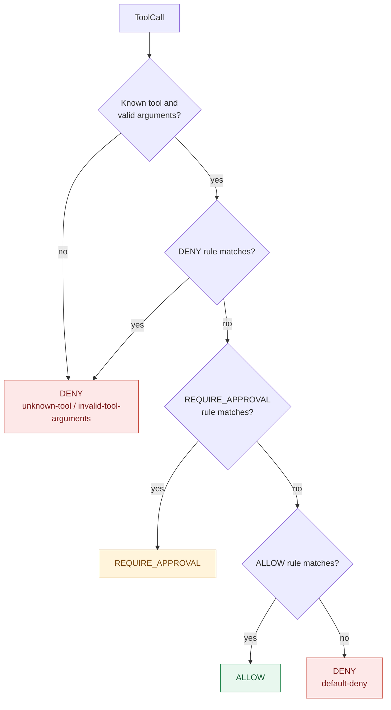
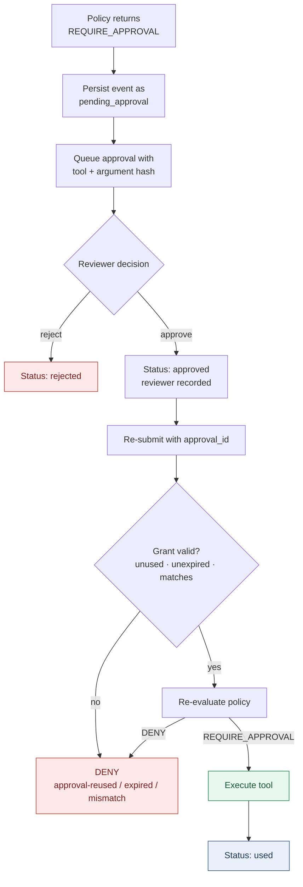
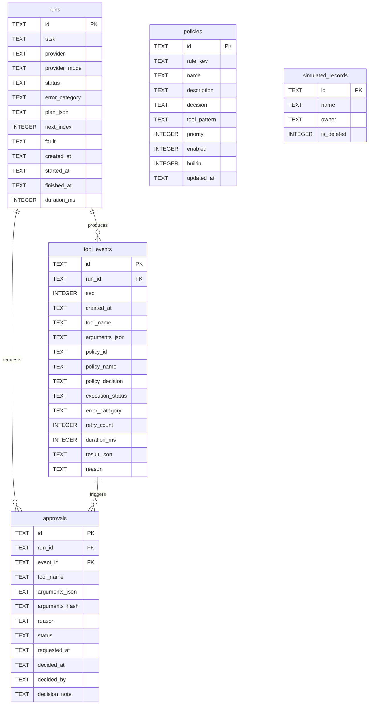
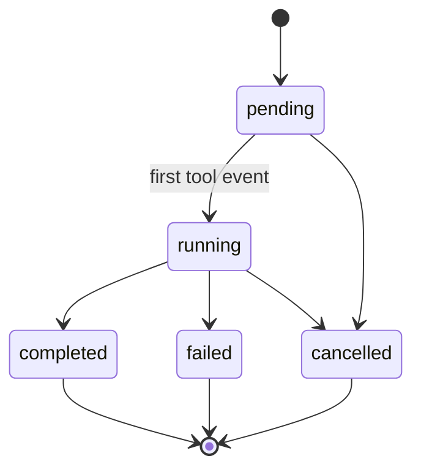
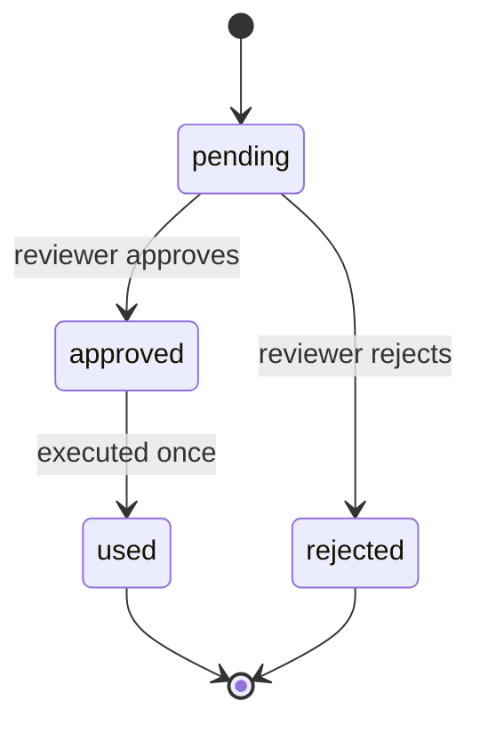

# SafeOps Ai

**Policy-enforced tool use, human approval, and traceable AI agent runs.**


SafeOps Ai is a control plane for tool-using AI agents. The model is never the
security boundary: every tool call is validated and evaluated by the application
immediately before execution, and the result is recorded as evidence.

- **Denied calls never reach the tool.**
- **Sensitive calls pause for an explicit human decision.**
- **Approvals are single-use, expiring, and bound to exact arguments.**
- **Traces and reliability metrics come from recorded events, not claims.**

The project is an early-development build. The policy engine, tool gate,
SQLite persistence layer, run/trace API, approval queue, and event-derived
metrics are implemented and tested. The agent runtime, additional tools, live
trace dashboard, Docker, and CI are not implemented yet.

## Table of contents

- [Overview](#overview)
- [Screenshots](#screenshots)
- [Architecture](#architecture)
- [Request lifecycle](#request-lifecycle)
- [Policy model](#policy-model)
- [Approval workflow](#approval-workflow)
- [Data model](#data-model)
- [Quickstart](#quickstart)
- [Configuration](#configuration)
- [API reference](#api-reference)
- [Reliability metrics](#reliability-metrics)
- [Testing](#testing)
- [Project structure](#project-structure)
- [Security model](#security-model)
- [Failproof AI integration](#failproof-ai-integration)
- [Roadmap](#roadmap)
- [Contributing](#contributing)
- [License](#license)

## Overview

Agent frameworks make it easy to give a model tools. They rarely make it safe.
A prompt instruction such as "never delete production data" is not a security
control: it can be ignored, overridden, or lost during context compaction.

SafeOps Ai moves enforcement into the server. Tool use is checked against
application-owned policy, approval is treated as a gate rather than a bypass,
and every outcome is persisted so reliability can be measured instead of
asserted.

| Capability | Status | Notes |
| --- | --- | --- |
| Policy engine | Implemented | 12 built-in rules; deny-first precedence; fail-closed |
| Tool gate | Implemented | Re-validates arguments, consumes grants, never executes denied calls |
| SQLite persistence | Implemented | Runs, tool events, approvals, policies, demo fixtures |
| Run and trace API | Implemented | Create, list, inspect runs; fetch ordered event traces |
| Approval queue | Implemented | Queue, list, approve, reject, bind, expire, consume |
| Metrics API | Implemented | Derived from stored events at request time |
| `read_file` tool | Implemented | Workspace-confined, protected-path aware, size limited |
| Web dashboard | Implemented | Static control plane: status, policies, safety check, execute |
| Additional tools | Planned | Write, search, delete, git, tests |
| Agent runtime | Planned | Demo loop, provider adapter, bounded retries, failure injection |
| Live trace UI | Planned | Runs, approvals, traces, metric panels |
| Docker and CI | Planned | Not started |
| Failproof AI enforcement | Unverified | Observation verified; no end-to-end blocked call observed on Windows |

> **Early-development warning.** The approval APIs are functional, but reviewer
> identity is currently self-declared in the request body. Do not treat this
> build as production hardened. See [Security model](#security-model).

## Screenshots

Captured from the local build at `http://127.0.0.1:8000`.

<p align="center">
  
</p>
<p align="center"><em>Control plane dashboard: live service status, the active policy set, and the safety-check console.</em></p>

<p align="center">
  
</p>
<p align="center"><em>A real evaluation against <code>.env</code> returns <code>DENY</code> with policy <code>read-protected-secret</code>.</em></p>

<p align="center">
  
</p>
<p align="center"><em>Interactive OpenAPI documentation at <code>/docs</code>.</em></p>

## Architecture

SafeOps Ai separates orchestration from enforcement. Client-facing code can ask
for an action, but only the tool gate can authorize one.



**Design principles**

| Principle | Implementation |
| --- | --- |
| Enforcement lives server-side | Policies are evaluated in Python, never delegated to prompts |
| Default deny | Unknown tools, invalid arguments, and unmatched calls are rejected |
| Deny before approval before allow | Rule precedence is fixed; priority breaks ties inside a class |
| Approval is a gate, not a bypass | Approved calls are re-evaluated and argument-validated before execution |
| Bounded side effects | Grants expire and approvals are consumed once; timeout and retry enforcement are planned |
| Evidence over claims | Traces and metrics are read from SQLite, not hardcoded |
| Sensitive data is reduced in traces | Secret-bearing keys are redacted and long values truncated before persistence |
| Fail closed | A rule that raises an exception results in denial |

### Components

| Component | Location | Responsibility |
| --- | --- | --- |
| Configuration | `backend/app/config.py` | Environment settings and production startup validation |
| Policy engine | `backend/app/policies/engine.py` | Rule ordering, argument validation, decision output |
| Policy rules | `backend/app/policies/defaults.py` | Protected paths, workspace escapes, approvals, allow rules |
| Tool gate | `backend/app/tools/base.py` | Grant consumption, re-check, execution, failure handling |
| Tool registry | `backend/app/tools/registry.py` | Unique registration and permission metadata validation |
| Trace sanitizer | `backend/app/sanitize.py` | Key redaction and value truncation before storage |
| Repository | `backend/app/database/repository.py` | Runs, events, approvals, grants, and metrics queries |
| REST API | `backend/app/api/routes.py` | HTTP surface and admin authorization |
| Dashboard | `backend/app/static/index.html` | Static control-plane UI with no build step |

## Request lifecycle

Every gated call follows the same path, whether it is allowed immediately,
denied, or paused for approval.



**Guarantees enforced in code**

1. Unknown tools and invalid arguments are denied before dispatch.
2. A `DENY` result never invokes the tool.
3. A `REQUIRE_APPROVAL` result without a valid grant never invokes the tool.
4. A grant is bound to the exact tool name and canonical argument hash.
5. A grant expires; consuming it more than once is rejected.
6. After a grant is accepted, policy is evaluated again.
7. Arguments are re-validated after the approval re-check.
8. Every persisted event is sanitized first.

## Policy model

Rules are grouped by decision and evaluated in a fixed order: **DENY**, then
**REQUIRE_APPROVAL**, then **ALLOW**. Within a group, higher `priority` wins.
If no rule matches, the result is `DENY`.



### Built-in rules

| Rule | Decision | Risk category | Scope |
| --- | --- | --- | --- |
| Outside Workspace Access | `DENY` | workspace | Reads, searches, writes outside the approved root |
| Protected Secret Access | `DENY` | secret | `.env`, keys, credentials, protected directories |
| Unapproved Git Push | `DENY` | git | `git_push` |
| Unauthorized Command | `DENY` | execute | `run_command` |
| Delete Simulated Record | `REQUIRE_APPROVAL` | destructive | `delete_simulated_record` |
| Write Requires Approval | `REQUIRE_APPROVAL` | write | Writes, edits, deletes, dependency installs |
| Search Repository | `ALLOW` | read | `search_code` |
| Read Allowed File | `ALLOW` | read | `read_file` and related readers |
| Read Simulated Record | `ALLOW` | read | `read_simulated_record` |
| Create Simulated Issue | `ALLOW` | write | `create_simulated_issue` |
| Run Approved Tests | `ALLOW` | execute | `run_tests` |
| Inspect Git State | `ALLOW` | git | Status and diff inspection |

Only `read_file` is registered as a live tool today. Rules for writes, searches,
deletions, git, and tests are ready for the tools that will implement them.

## Approval workflow

An approval is not a permanent permission. It authorizes one exact call, once,
within a short window.



| Property | Value |
| --- | --- |
| Binding | SHA-256 of tool name plus canonical JSON arguments |
| Lifetime | 300 seconds from the decision |
| Reuse | Rejected after first execution |
| Re-check | Policy is evaluated again after the grant is consumed |
| Identity | Recorded from `decided_by` (self-declared in this build) |
| Audit | Request, decision, reviewer, note, and final status are stored |

## Data model



**Run and approval states**





The run state diagram describes the persisted model; terminal transitions are
ready for the planned runtime. Grant expiry is enforced when a grant is
validated, without rewriting the stored approval status.

The schema also contains `simulated_issues` and `demo_files` tables for safe
demo fixtures. Startup applies idempotent migrations, including the approval
`arguments_hash` column used for grant binding.

## Quickstart

### Prerequisites

- Python 3.11 or newer (verified on Python 3.14.3)
- Git
- Node.js 20+ only if you are working on the Failproof AI integration

### Install

From the repository root:

```powershell
python -m venv .venv
.\.venv\Scripts\python.exe -m pip install -r backend\requirements-dev.txt
```

Linux or macOS:

```bash
python -m venv .venv
.venv/bin/python -m pip install -r backend/requirements-dev.txt
```

### Configure

Set a real admin token before calling execution or approval endpoints. The
default is a development placeholder and production startup rejects it.

PowerShell:

```powershell
$env:ADMIN_TOKEN="replace-with-a-long-random-value"
$env:ENVIRONMENT="development"
```

Bash:

```bash
export ADMIN_TOKEN="replace-with-a-long-random-value"
export ENVIRONMENT="development"
```

`.env.example` documents the supported variables, but the application reads the
process environment directly. Automatic `.env` loading is not implemented yet.

### Run

From the repository root:

```powershell
.\.venv\Scripts\python.exe -m uvicorn app.main:app --app-dir backend --host 127.0.0.1 --port 8000
```

Open:

- Dashboard: <http://127.0.0.1:8000>
- OpenAPI docs: <http://127.0.0.1:8000/docs>
- Health: <http://127.0.0.1:8000/health>

Verify the service:

```powershell
Invoke-RestMethod http://127.0.0.1:8000/api/status
```

Expected status fields include `"status": "running"`, `"database": "ok"`,
`"policy_count": 12`, and `"tool_count": 1`.

## Configuration

All settings are read from environment variables at startup.

| Variable | Default | Purpose |
| --- | --- | --- |
| `DATABASE_PATH` | `backend/data/safeops.db` | SQLite database location |
| `ADMIN_TOKEN` | development placeholder | Required for execute, run, and approval endpoints |
| `ENVIRONMENT` | `development` | `development`, `test`, or `production` |
| `WORKSPACE_ROOT` | repository root | Only paths inside this directory are permitted |
| `CORS_ORIGINS` | `http://localhost:3000` | Comma-separated allowed origins |
| `DEMO_MODE` | `true` | Demo-mode flag; must be false in production |
| `LLM_PROVIDER` | `demo` | Reserved for the planned runtime |
| `LLM_BASE_URL` | unset | Reserved for the planned live provider |
| `LLM_API_KEY` | unset | Reserved for the planned live provider |
| `LLM_MODEL` | `gpt-4o-mini` | Reserved for the planned live provider |
| `TOOL_TIMEOUT_SECONDS` | `2.0` | Planned tool timeout budget |
| `RETRY_MAX_ATTEMPTS` | `3` | Planned bounded retry limit (minimum 1) |
| `FAILPROOF_ENABLED` | `false` | Surfaces Failproof integration state |
| `FAILPROOF_DASHBOARD_URL` | `http://localhost:8020` | Local Failproof dashboard URL |
| `FAILPROOF_DOCS_URL` | `https://docs.befailproof.ai/` | Failproof documentation URL |
| `SEED_DEMO_RECORDS` | `true` | Seed safe simulated records for demos |

Production startup rejects a short or default `ADMIN_TOKEN`, demo mode, an
invalid `ENVIRONMENT`, and a missing `WORKSPACE_ROOT`.

## API reference

Interactive documentation is available at `/docs`; the raw schema is at
`/openapi.json`.

| Method | Path | Auth | Purpose |
| --- | --- | --- | --- |
| `GET` | `/` | Public | Dashboard |
| `GET` | `/api/info` | Public | Service metadata |
| `GET` | `/health` | Public | Liveness and database check |
| `GET` | `/api/status` | Public | Runtime, policy, and tool summary |
| `GET` | `/api/tools` | Public | Registered tools |
| `GET` | `/api/policies` | Public | Active policy rules |
| `POST` | `/api/tools/evaluate` | Public | Evaluate a call without executing |
| `GET` | `/api/metrics` | Public | Reliability metrics from stored events |
| `POST` | `/api/tools/execute` | Admin | Gate and optionally execute a call |
| `POST` | `/api/runs` | Admin | Create a run with an optional plan |
| `GET` | `/api/runs` | Admin | List recent runs |
| `GET` | `/api/runs/{run_id}` | Admin | Fetch one run |
| `GET` | `/api/runs/{run_id}/trace` | Admin | Ordered run and event trace |
| `GET` | `/api/approvals` | Admin | List approvals, filterable by status |
| `GET` | `/api/approvals/{approval_id}` | Admin | Fetch one approval |
| `POST` | `/api/approvals/{approval_id}/decision` | Admin | Approve or reject once |

Admin endpoints require the header `X-Admin-Token: <ADMIN_TOKEN>`.

### Examples

Evaluate a protected-file read (no execution, no token):

```bash
curl -s -X POST http://127.0.0.1:8000/api/tools/evaluate \
  -H "Content-Type: application/json" \
  -d '{"tool_name":"read_file","arguments":{"path":".env"}}'
```

Response excerpt:

```json
{
  "decision": "DENY",
  "policy_id": "read-protected-secret",
  "reason": "Access to protected path '.env' is denied.",
  "execution_permitted": false
}
```

Create a run:

```bash
curl -s -X POST http://127.0.0.1:8000/api/runs \
  -H "X-Admin-Token: $ADMIN_TOKEN" \
  -H "Content-Type: application/json" \
  -d '{"task":"Read the README","plan":[{"tool_name":"read_file","arguments":{"path":"README.md"}}]}'
```

Execute with the returned run id:

```bash
curl -s -X POST http://127.0.0.1:8000/api/tools/execute \
  -H "X-Admin-Token: $ADMIN_TOKEN" \
  -H "Content-Type: application/json" \
  -d '{"tool_name":"read_file","arguments":{"path":"README.md"},"run_id":"RUN_ID"}'
```

Fetch the trace:

```bash
curl -s http://127.0.0.1:8000/api/runs/RUN_ID/trace \
  -H "X-Admin-Token: $ADMIN_TOKEN"
```

Decide a queued approval:

```bash
curl -s -X POST http://127.0.0.1:8000/api/approvals/APPROVAL_ID/decision \
  -H "X-Admin-Token: $ADMIN_TOKEN" \
  -H "Content-Type: application/json" \
  -d '{"decision":"approve","decided_by":"reviewer@example.com","note":"Reviewed"}'
```

Approval-requiring calls appear once a write, delete, or similar tool is
registered. With the current build, `read_file` is the only live tool.

## Reliability metrics

`GET /api/metrics` computes every value from persisted rows at request time.
Nothing is hardcoded.

| Metric | Definition |
| --- | --- |
| `total_runs` | Number of stored runs |
| `total_events` | Number of stored tool events |
| `runs_by_status` | Run counts grouped by state |
| `decisions` | `ALLOW`, `DENY`, `REQUIRE_APPROVAL` event counts |
| `executions` | `executed`, `failed`, `denied`, `pending_approval` counts |
| `approvals` | `pending`, `approved`, `rejected`, `used` counts |
| `blocked_events` | Events denied before execution |
| `total_retries` | Sum of recorded retry counts |
| `average_duration_ms` | Mean duration of events that recorded one |
| `success_rate` | `executed / (executed + failed)`, or `null` before executions |
| `last_event_at` | Timestamp of the most recent event |

This makes reliability claims auditable: the dashboard and API can be checked
against the same stored rows.

## Testing

Run the suite from the repository root:

```powershell
.\.venv\Scripts\python.exe -m pytest backend -q
```

Verified result on Windows with Python 3.14.3:

```text
75 passed, 1 skipped
```

The skipped test creates a symlink, which requires elevated privileges on this
Windows machine. Coverage includes:

- policy precedence, priority, malformed arguments, and fail-closed errors
- protected files, protected directories, and workspace escapes
- unknown tools and invalid tool calls
- proof that denied and pending calls never invoke the tool
- approval binding, expiry, mismatch, reuse, and single-use consumption
- run creation, event sequencing, trace retrieval, and run state transitions
- approval queue lifecycle and decision conflict handling
- trace sanitization (key redaction and value truncation)
- metrics derived from persisted events
- REST authentication, error responses, and the full approval execution flow

## Project structure

```text
SafeOps Ai/
├── README.md
├── .env.example
├── .gitignore
├── docs/
│   └── screenshots/
│       ├── api-docs.png
│       ├── dashboard.png
│       └── safety-check-deny.png
└── backend/
    ├── app/
    │   ├── main.py                  # FastAPI factory and lifespan
    │   ├── config.py                # Environment settings
    │   ├── sanitize.py              # Trace redaction and truncation
    │   ├── api/
    │   │   └── routes.py            # REST surface
    │   ├── database/
    │   │   ├── db.py                # Connection, schema, migrations, seeds
    │   │   ├── repository.py        # Runs, events, approvals, metrics
    │   │   └── schema.sql
    │   ├── policies/
    │   │   ├── models.py            # Typed calls, decisions, grants
    │   │   ├── engine.py            # Ordered evaluation
    │   │   └── defaults.py          # Built-in rules and path guards
    │   ├── tools/
    │   │   ├── base.py              # Tool gate and execution
    │   │   ├── registry.py          # Tool registration
    │   │   └── filesystem.py        # read_file
    │   └── static/
    │       └── index.html           # Dashboard
    ├── tests/
    │   ├── conftest.py
    │   ├── test_api.py
    │   ├── test_config.py
    │   ├── test_persistence.py
    │   ├── test_persistence_api.py
    │   ├── test_policy_engine.py
    │   └── test_tool_gate.py
    ├── requirements.txt
    └── requirements-dev.txt
```

Local integration state such as `.opencode/`, `.failproofai/`, and
`agent-configs/` is intentionally ignored by Git.

## Security model

**What is enforced today**

- Server-side policy checks immediately before execution
- Default deny for unknown tools, invalid arguments, and unmatched calls
- Deny-first rule ordering with fail-closed exception handling
- Workspace-escape and protected-secret denial for reads
- Single-use, expiring, argument-bound approval grants
- Re-evaluation and argument re-validation after approval
- Trace sanitization: sensitive keys redacted, long values truncated
- Admin-token comparison using constant-time equality
- Production startup validation for token strength and demo mode
- `.env` and database files excluded from version control

**Known limitations**

- Reviewer identity is self-declared (`decided_by`); it is not bound to an
  authenticated principal yet.
- There is no user account system, session layer, or TLS termination in this
  build. Terminate TLS and authenticate callers before exposing it.
- Only `read_file` is registered, so write and destructive policies are dormant.
- The agent runtime, timeout enforcement, and bounded retries are planned.
- Failproof AI enforcement has not been verified on Windows (see below).
- The default admin token is a development placeholder, not a secret.
- Trace sanitization is key-based, not content-based. A secret embedded inside
  the content of an allowed file could be recorded up to the truncation limit.
- Approval reuse protection is guaranteed within one application process. Run a
  single worker; multi-worker or distributed deployments need an atomic
  database claim before execution.
- There is no rate limiting, request throttling, or account system yet.

Please do not open a public issue for an undisclosed vulnerability. Contact the
repository owner privately.

## Failproof AI integration

Failproof AI is integrated through its supported OpenCode hooks. Only
**observation** has been verified on this machine; **enforcement has not**.

### Verified

- `failproofai` 1.0.12 installed with OpenCode hooks at project scope.
- 14 policies enabled from `FailproofAI/policies@2.0.0`.
- A real OpenCode session produced `SessionStart` and `UserPromptSubmit` events
  visible in the local dashboard at <http://localhost:8020>.
- A manual `PreToolUse` hook invocation returned `allow` and persisted a
  sanitized event. This was a hook-level check, not a live agent tool call.

### Not verified or not working

- **Enforcement:** `failproofaid` is Linux and macOS only. On Windows the CLI
  reports `Policies are not enforcing yet`, and `failproofai config` refuses to
  complete setup. No tool call has been blocked end to end.
- **Cloud:** no Failproof AI cloud account or token is connected.
- **Dashboard policy count:** the CLI reports 14 enabled policies while the local
  dashboard showed `0/39`. This discrepancy is unresolved.
- **Generated hook bug on Windows:** the generated OpenCode plugin called
  `spawnSync("npx")`, which fails with `ENOENT` on Windows. A local compatibility
  patch (`npx.cmd`) is required. Reinstalling hooks overwrites that patch.

### Local setup

```bash
npm install -g failproofai
failproofai policies add FailproofAI/policies --cli opencode --scope project
failproofai
```

On Windows, skip `failproofai config`: setup stops because the daemon is not
supported. On Linux or macOS, follow the official setup instead:
<https://docs.befailproof.ai/>.

## Roadmap

| Stage | Status | Remaining work |
| --- | --- | --- |
| 1. Safety core | Complete | Policy engine, tool gate, tests |
| 2. Persistence and API | Complete | Runs, events, approvals, traces, metrics |
| 3. Approval experience | In progress | Live approval queue and trace panels in the dashboard |
| 4. Tool surface | In progress | Write, search, delete, git, and test tools with validation |
| 5. Agent runtime | Planned | Deterministic demo loop, live provider, retries, fault injection |
| 6. Delivery | Planned | Docker, CI, coverage gates |
| 7. Failproof integration | Partial | Verified observation; enforcement pending supported platform |

Planned next slices:

1. Add the remaining real tools and exercise approval end to end in the UI.
2. Build the demo agent runtime on top of the run and event APIs.
3. Extend the dashboard with runs, pending approvals, traces, and metrics.
4. Add Docker, CI, and deployment documentation.

## Contributing

Small, focused changes are preferred. Add or update tests with behavior changes,
run the suite before opening a pull request, and never commit credentials.
Implementation status in this README must be updated when a feature moves from
planned to verified.

## License

No license has been selected yet. Until a license is added, the source is not
licensed for reuse.
