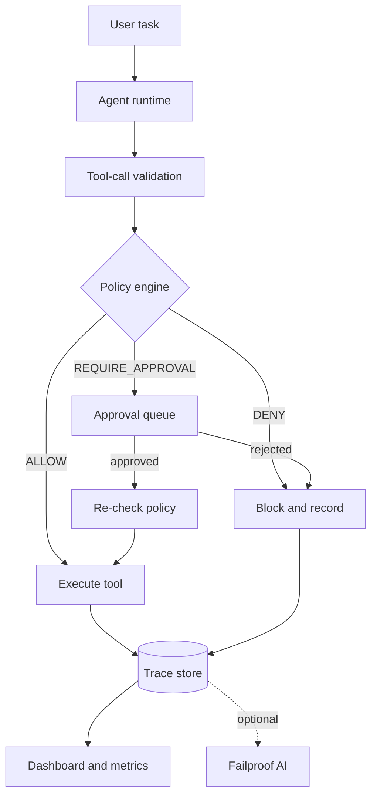

# SafeOps Ai

**Policy-enforced tool use, human approval, and traceable AI agent runs.**


> **Project status: early development.** The policy engine, agent runtime, REST API,
> dashboard, approval queue, and automated tests are **not implemented yet**. This
> README documents the design and only the work that has actually been verified.

SafeOps Ai is a platform for running tool-using AI agents under
application-enforced safety policies. Every tool call is intended to pass through
a server-side checkpoint that returns `ALLOW`, `DENY`, or `REQUIRE_APPROVAL`
*before* execution.

- Denied calls never reach the underlying tool.
- Sensitive calls wait for an explicit human decision.
- Every decision and outcome is recorded so failures can be investigated.

The project is being built for the Hacktoberfest Meetup Bengaluru × Failproof AI.

## Why SafeOps Ai

- **The model is not the security boundary.** Policies are enforced by the
  application runtime, not by prompt instructions.
- **Default deny.** Unknown tools and invalid arguments are rejected.
- **Human approval for destructive actions.** Deleting a record or applying a
  risky action pauses the run until a reviewer decides.
- **Bounded side effects.** Timeouts and limited retries apply only where they are
  safe; non-idempotent operations are not retried automatically.
- **Evidence over claims.** Reliability metrics are calculated from recorded
  events, never hardcoded.
- **Secrets stay out of traces.** Tool arguments and results are sanitized before
  they are persisted.

## Project status

| Area | Status |
| --- | --- |
| Repository and documentation | In progress |
| Backend configuration and SQLite data model | Scaffold present |
| Policy engine | Not started |
| Simulated tools and argument validation | Not started |
| Agent runtime with deterministic demo mode | Not started |
| Run and trace persistence | Schema only |
| Human approval queue | Not started |
| REST API | Not started |
| Dashboard (planned Next.js) | Not started |
| Failure injection and bounded retries | Not started |
| Reliability metrics | Not started |
| Automated tests | Not started |
| CI and Docker | Not started |
| Failproof AI integration | Observation verified locally; enforcement unavailable on Windows |

## Target architecture

The following is the **target design**, not the current implementation. Only the
configuration module and the database schema exist today.



Every tool call must pass through validation and the policy engine immediately
before execution. Approval is a gate, not a bypass: an approved action is
re-checked before it runs.

## Current implementation

### Configuration

`backend/app/config.py` contains environment-driven settings for the database
path, CORS origins, demo mode, optional LLM provider, tool timeout, retry limit,
and the optional Failproof AI adapter.

The default `ADMIN_TOKEN` is a development placeholder, not a secret. Set a real
value before exposing approval endpoints.

### Database schema

`backend/app/database/schema.sql` defines the initial SQLite model:

- `runs` — agent runs, status, plan, retry context, timing
- `tool_events` — sanitized tool calls, policy decision, execution status, retries
- `approvals` — pending, approved, and rejected actions with reviewer metadata
- `policies` — rule metadata, decision, priority, enabled state
- `simulated_issues` and `simulated_records` — safe fixtures for simulated tools
- `demo_files` — sample file contents for the demo workspace

There is no database access layer or query code yet.

### What is not implemented

There is currently **no runnable FastAPI application**. The planned entrypoint is
`app.main:app`, but `main.py` does not exist yet. Do not expect `uvicorn` to
start the project at this stage.

Also not implemented: tool registry, policy evaluation, orchestration, approval
workflow, failure injection, metrics, dashboard, and tests.

## Failproof AI integration

Failproof AI is integrated through its supported OpenCode hooks. Only
**observation** has been verified on this machine; **enforcement has not**.

### Verified

- `failproofai` 1.0.12 installed with OpenCode hooks at project scope.
- 14 policies enabled from `FailproofAI/policies@2.0.0`.
- A real OpenCode session produced `SessionStart` and `UserPromptSubmit` events
  that were visible in the local Failproof dashboard at `http://localhost:8020`.
- A manual `PreToolUse` hook invocation returned `allow` and persisted a sanitized
  event. This was a hook-level check, not a live agent tool call.

### Not verified or not working

- **Enforcement:** `failproofaid` is Linux and macOS only. On Windows the CLI
  reports `Policies are not enforcing yet`, and `failproofai config` refuses to
  complete setup. No tool call has been blocked end to end.
- **Cloud:** no Failproof AI cloud account or token is connected.
- **Dashboard policy count:** the CLI reports 14 enabled policies while the local
  dashboard showed `0/39`. This discrepancy is unresolved.
- **Generated hook bug on Windows:** the generated OpenCode plugin called
  `spawnSync("npx")`, which fails with `ENOENT` on Windows. A local compatibility
  patch (`npx.cmd`) is required. Reinstalling hooks overwrites that patch.

### Local setup

```bash
npm install -g failproofai
failproofai policies add FailproofAI/policies --cli opencode --scope project
failproofai
```

On Windows, skip `failproofai config`: setup stops because the daemon is not
supported. On Linux or macOS, follow the official setup instead:

<https://docs.befailproof.ai/>

The local hook directory (`.opencode/`), policy state (`.failproofai/`), and the
archived per-agent configuration folder (`agent-configs/`) are intentionally
ignored by Git. They contain machine-specific integration state and must not be
committed.

## Getting started

### Prerequisites

- Python 3.11 or newer (dependency installation verified on Python 3.14.3)
- Git
- Node.js 20+ and Failproof AI only if you are working on the integration

### Install backend dependencies

```bash
cd backend
python -m venv .venv
```

Windows:

```powershell
.\.venv\Scripts\python.exe -m pip install -r requirements-dev.txt
```

Linux or macOS:

```bash
.venv/bin/python -m pip install -r requirements-dev.txt
```

These dependencies are installed, but there is **no application entrypoint yet**,
so no server start command is documented until the first runnable slice lands.

### Configuration

Copy `.env.example` to `.env` and change `ADMIN_TOKEN` before using approval
features. Never commit `.env`.

## Testing

There are no automated tests yet. `pytest backend` currently collects zero tests.

Planned coverage:

- every policy decision (`ALLOW`, `DENY`, `REQUIRE_APPROVAL`)
- invalid and unknown tool arguments
- proof that a denied action never invokes the underlying tool
- proof that an approval-required action does not execute before approval
- approval authorization and decision recording
- bounded retries and timeout behavior
- trace persistence and sanitization
- metrics calculated from stored events
- API validation and error responses

## Roadmap

1. **Safety core** — policy engine, argument validation, simulated tools, and tests
   proving denial and approval gates.
2. **Persistence and API** — runs, events, approvals, trace endpoints, and metrics
   derived from recorded data.
3. **Agent runtime** — deterministic demo mode, optional live provider adapter,
   bounded retries, and failure injection.
4. **Dashboard** — Next.js trace explorer, approval queue, policy view, and
   reliability metrics wired to real API data.
5. **Integration and delivery** — verified Failproof AI observation, Docker, CI,
   and documentation of verified enforcement status.

## Repository layout

```text
SafeOps Ai/
├── README.md
├── .env.example
├── .gitignore
└── backend/
    ├── app/
    │   ├── __init__.py
    │   ├── config.py
    │   └── database/
    │       ├── __init__.py
    │       └── schema.sql
    ├── requirements.txt
    └── requirements-dev.txt
```

Local-only integration state such as `.opencode/`, `.failproofai/`, and
`agent-configs/` is not part of the repository.

## Security

- Enforce policy checks on the server, immediately before tool execution.
- Default to deny for unknown tools and invalid arguments.
- Never log API keys, tokens, authorization headers, or environment file contents.
- Keep `.env` and database files out of version control.
- Do not claim enforcement works without an observed blocked call.

Please do not open a public issue for an undisclosed vulnerability. Contact the
repository owner privately.

## Contributing

Small, focused changes are preferred. Add or update tests with behavior changes,
run the test suite before opening a pull request, and never commit credentials.
Implementation status in this README must be updated when a feature moves from
planned to verified.

## License

No license has been selected yet. Until a license is added, the source is not
licensed for reuse.

## Acknowledgements

Built for the Hacktoberfest Meetup Bengaluru × Failproof AI.

Failproof AI: <https://github.com/FailproofAI/failproofai>
